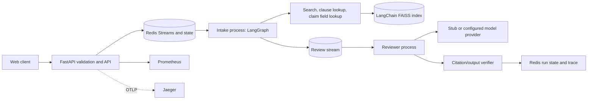

# Air Passenger Claim Triage

An asynchronous, evidence-grounded triage service for air passenger claims. Recommendations support a customer relations officer; the service never authorizes or issues payment.

## Start and run

Requires Docker Desktop in Linux-container mode with its engine running:

```sh
docker compose up --build
```

Open the client at http://localhost:8080, API docs at http://localhost:8000/docs, Jaeger at http://localhost:16686, Prometheus at http://localhost:9090, and Grafana at http://localhost:3000. Grafana permits anonymous viewer access for local coursework use.

Submit a `POST /v1/claims`; it returns HTTP 202 with a run ID. Poll `GET /v1/runs/{run_id}`, inspect all steps at `/v1/runs/{run_id}/trace`, and submit feedback at `/v1/runs/{run_id}/feedback`. OpenAPI is at `/openapi.json`; health and Prometheus metrics are `/healthz` and `/metrics`.

## Architecture



Compose runs API, Redis, intake agent, review agent, dashboard, model stub, Jaeger, Prometheus, Grafana, and cAdvisor. API and agent roles have independent release/failure boundaries. Separate Redis Streams consumer groups provide back-pressure and allow abandoned deliveries to be reclaimed. Scale intake workers with `docker compose up --scale intake-agent=3`; scale review workers separately. cAdvisor supplies container CPU and memory metrics.

The intake agent uses a bounded LangGraph plan that chooses among three retrieval/claim-field tools, follows clause references, and hands facts plus passages to a separate review process. The reviewer applies the rule adapter, asks the configured provider for a structured advisory, rejects any changed route/citation or unauthorized wording, verifies citation IDs and quoted text against retrieved passages, then retries condition-focused search or escalates. Tool calls, passages, prompt versions, token counts, cost, step latency, verification, and correlation ID are stored on each run.

## Contract and safeguards

See [docs/data-contracts.md](docs/data-contracts.md). Schema, type, range, timestamp, category, and cross-field validation happen before a run is queued. Invalid records and injection/toxicity flags are quarantined with field errors. Rate limiting is per `X-Client-Id` (30/minute by default). The client can provide fare inputs for cancellation compensation computation. The result is always an officer recommendation, not authorization.

Free-text fields reaching the model receive an instruction-injection and simple toxicity screen. Model output must match the rule-derived position, route, recommendation, and citation set. A mismatch, provider error, or failed evidence check resolves to human escalation. The demo toggles `STUB_UNSUPPORTED_OUTPUT=true` to exercise rejection of an invented citation, and `STUB_FAIL=true` to exercise the provider retry/circuit-breaker fallback. Restore both to `false` afterward.

For the brief's cancellation case (90-minute notice, passenger at airport, accepted alternate four hours later), the system returns `request_further_evidence`: the alternate remedy was accepted, so cancellation compensation is not recommended on those facts, while meals/refreshments during the airport wait are checked under CAR 3.3.2 and 3.8.1(a).

## Corpus and retrieval

`corpus/dgca_car_rev4.pdf` is the DGCA Revision 4 source PDF. `corpus/dgca_car.json` contains clause-preserving passages with source/page metadata, including linked conditions, exceptions, and facilities clauses. The Air India-hosted Passenger Charter's indexed cancellation clause is included as a secondary excerpt with source URL and provenance note; its 12.8 MB original could not be downloaded from this environment. This limitation is recorded in the corpus metadata.

Rebuild clause passages inside the API image:

```sh
docker compose run --rm api python -m app.ingest --rebuild
docker compose run --rm api python -m app.retrieval --rebuild
```

Restart the API and agents after rebuilding so every process reloads the new corpus and index:

```sh
docker compose restart api intake-agent review-agent dashboard
```

The index uses local TF-IDF unigram/bigram embeddings in a LangChain FAISS vector store, plus lexical matching. Index build is idempotent, and passage metadata retains clause IDs so a retrieved entitlement can be expanded to referenced conditions. Redis caches retrievals for one hour by corpus version and query; set `CACHE_RETRIEVALS=false` to measure the uncached path. No paid embedding service is used.

## Provider configuration

The default provider is the separate deterministic HTTP stub with configurable delay. For an OpenAI-compatible provider, set `MODEL_PROVIDER=openai_compatible` and inject `MODEL_API_BASE`, `MODEL_API_KEY`, `MODEL_NAME`, timeout, and per-1K token rates at runtime; no credential or model identifier is committed. The adapter retries with exponential backoff, times out calls, opens a Redis-backed circuit after repeated failures, records token/cost data, and escalates when the provider cannot complete. Prompt artifacts are in `prompts/`; choose `PROMPT_VERSION` at runtime.

## Evaluation and operations

Run the fixed batch with `python -m app.evaluation`. The 20 scenarios are in `eval/scenarios.json`; the generated before/after report is `eval/latest-report.json`. It compares triage-v1 single-pass retrieval with triage-v2 condition and cross-reference retrieval. Metric definitions are included in the report. Live runs are sampled automatically for groundedness, context relevance, faithfulness, and hallucination rate; `/v1/quality` returns those samples and Grafana plots their rolling means.

The predeclared stub SLO is p95 <= 5 seconds from submission through completed result at 20 concurrent users. The benchmark harness records a `submission-to-result` Locust sample:

```sh
docker compose --profile benchmark run --rm locust --headless -u 20 -r 5 --run-time 2m --csv eval/locust
```

Do not treat submission latency alone as the run SLO. The Docker-backed load and scale runs are not claimed until executed on a working Docker engine; record RPS, p50/p95, concurrency break point, and bottleneck in the evaluation report.

Operational recovery steps are in [docs/runbook.md](docs/runbook.md). A genuine development incident is recorded in [docs/incident-log.md](docs/incident-log.md).

## Implementation status

The corpus ingest, API, two agent processes, FAISS retrieval, provider boundary, stub, Redis Streams, citation/output checks, Prometheus metrics, Jaeger traces, Grafana dashboard, Locust harness, evaluation set, prompt versions, feedback, rate limiting, and runbook are implemented. Container startup, Docker-backed SLO measurements, and worker-scale comparisons remain to be verified in the target environment.

