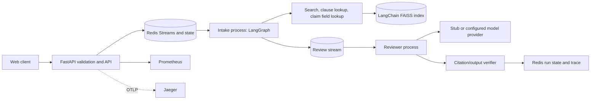

# Air Passenger Claim Triage

An asynchronous, evidence-grounded triage service for air passenger claims. Recommendations support a customer relations officer; the service never authorizes or issues payment.

## Start and run

Requires Docker Desktop in Linux-container mode with its engine running:

```sh
docker compose up --build
```

Open the client at http://localhost:8080, API docs at http://localhost:8000/docs, Jaeger at http://localhost:16686, Prometheus at http://localhost:9090, and Grafana at http://localhost:3000. Grafana permits anonymous viewer access for local coursework use.

Submit a `POST /v1/claims`; it returns HTTP 202 with a run ID. Poll `GET /v1/runs/{run_id}`, inspect all steps at `/v1/runs/{run_id}/trace`, and submit feedback at `/v1/runs/{run_id}/feedback`. OpenAPI is at `/openapi.json`; health and Prometheus metrics are `/healthz` and `/metrics`.

## Architecture



Compose runs the API, Redis, intake agent, review agent, browser client, model stub, Jaeger, Prometheus, Grafana, cAdvisor, and a Redis exporter. Service boundaries are chosen so API validation/queueing stays responsive, CPU-heavy retrieval and provider-dependent review scale separately, and model failure degrades to officer review. Intake and review workers reclaim abandoned Redis Stream deliveries after 60 seconds. Prometheus scrapes each application service and the monitoring/data services; worker replicas are discovered through Docker DNS. cAdvisor supplies per-container CPU, memory, and start-time metrics.

| Service | Responsibility | Scaling and failure behavior |
| --- | --- | --- |
| API | Validate, quarantine, rate-limit, enqueue, and serve status/trace/feedback. | Keep separate from slow agent work; Redis loss returns 503. |
| Intake agent | Extract fields, run the bounded LangGraph retrieval loop, and hand evidence to review. | Scale with `--scale intake-agent=3`; a failed task is marked failed and an unacknowledged delivery can be reclaimed. |
| Review agent | Apply rules, call the model boundary, verify citations, and finalize the recommendation. | Scale independently; a failed provider or reviewer check produces human escalation. |
| Redis | Durable queues, run state, quarantine, cache, feedback, and metrics. | AOF-backed volume; queue consumers reclaim pending messages. |
| Model stub | Fixed-response, delayed provider for local runs and load tests. | Replaceable provider boundary; failure and unsupported output are injectable. |
| Monitoring services | Traces, metrics, dashboards, and container resource data. | Isolated from request processing; loss does not change claim adjudication. |

The intake agent uses a bounded LangGraph plan that chooses among three retrieval/claim-field tools, follows clause references, and hands facts plus passages to a separate review process. The reviewer applies the rule adapter, asks the configured provider for a structured advisory, rejects any changed route/citation or unauthorized wording, verifies citation IDs and quoted text against retrieved passages, then retries condition-focused search or escalates. Tool calls, passages, prompt versions, token counts, cost, step latency, verification, and correlation ID are stored on each run.

## Contract and safeguards

See [docs/data-contracts.md](docs/data-contracts.md). Schema, type, range, timestamp, category, and cross-field validation happen before a run is queued. Invalid records and injection/toxicity flags are quarantined with field errors. Rate limiting is per `X-Client-Id` (30/minute by default). The client can provide fare inputs for cancellation compensation computation. The result is always an officer recommendation, not authorization.

Free-text fields reaching the model receive an instruction-injection and simple toxicity screen. Model output must match the rule-derived position, route, and citation set exactly; the model may word the recommendation itself, but any clause it mentions must be one of the cited clauses, any amount must equal the computed amount, and authorising language is rejected. A mismatch, provider error, or failed evidence check resolves to human escalation. The demo toggles `STUB_UNSUPPORTED_OUTPUT=true` to exercise rejection of an invented citation, and `STUB_FAIL=true` to exercise the provider retry/circuit-breaker fallback. Restore both to `false` afterward.

The difficult cancellation case (90-minute notice, passenger at airport, accepted alternate four hours later) routes to `decline_with_cited_provision` under CAR 3.3.2: the airline must give either an acceptable alternate flight or compensation with a refund, and the passenger took the alternate, so no compensation is payable. The recommendation still states that meals and refreshments for the airport wait are owed under CAR 3.3.2 and 3.8.1(a). Cancellation claims are also declined, with the deciding clause cited, when notice was at least two weeks (CAR 3.3.1), when notice was 24 hours to two weeks and an alternate was offered (CAR 3.3.1), or when no contact details were given at booking (CAR 3.3.3). A decline is only issued if its deciding clause was actually retrieved; otherwise the claim escalates. If the structured disruption category conflicts with the passenger's account, or retrieved sources disagree on a provision's text, the workflow escalates.

## Corpus and retrieval

`corpus/dgca_car_rev4.pdf` is the DGCA Revision 4 source PDF. `corpus/dgca_car.json` contains clause-preserving passages with source/page metadata, including linked conditions, exceptions, and facilities clauses. The Air India-hosted Passenger Charter's indexed cancellation clause is included as a secondary excerpt with source URL and provenance note; its 12.8 MB original could not be downloaded from this environment. This limitation is recorded in the corpus metadata.

The one-command idempotent corpus pipeline parses, chunks, embeds, indexes, and records freshness. Run it inside the API image:

```sh
docker compose run --rm api python -m app.ingest
```

Pass `--rebuild` to force a full re-embedding and FAISS rebuild.

Add newly introduced clause IDs without rebuilding existing vectors:

```sh
docker compose run --rm api python -m app.retrieval --append
```

Restart the API and agents after rebuilding so every process reloads the new corpus and index:

```sh
docker compose restart api intake-agent review-agent dashboard
```

The index uses fixed-size local unigram/bigram hashing embeddings in a LangChain FAISS vector store, plus lexical matching. Index builds are idempotent; `--append` adds new passage IDs without re-embedding existing vectors, while `--rebuild` refreshes changed passages. Passage metadata retains clause IDs so a retrieved entitlement can be expanded to referenced conditions. Redis caches retrievals for one hour by corpus version and query; set `CACHE_RETRIEVALS=false` to measure the uncached path. No paid embedding service is used.

## Provider configuration

The default provider is the separate deterministic HTTP stub with configurable delay. For an OpenAI-compatible provider, set `MODEL_PROVIDER=openai_compatible` and inject `MODEL_API_BASE`, `MODEL_API_KEY`, `MODEL_NAME`, timeout, and per-1K token rates at runtime; no credential or model identifier is committed. The adapter retries with exponential backoff, times out calls, opens a Redis-backed circuit after repeated failures, records token/cost data, and escalates when the provider cannot complete. Prompt artifacts are in `prompts/`; choose `PROMPT_VERSION` at runtime.

## Evaluation and operations

Run the fixed batch inside the API image with `docker compose run --rm api python -m app.evaluation`. The 22 scenarios in `eval/scenarios.json` cover all four routes (2 pay-as-computed, 8 decline, 2 request-further-evidence, 10 escalation), including the section 4.1 case (E01). The generated before/after report is `eval/latest-report.json`. It compares triage-v1 single-pass retrieval with triage-v2 condition and cross-reference retrieval. Current results, before → after: accuracy 0.545 → 1.0, groundedness 0.909 → 1.0, hallucination rate 0.455 → 0.0, context relevance 0.091 → 0.377, faithfulness 1.0 → 1.0. Single-pass retrieval misses the deciding condition clauses (3.3.1, 3.3.3), so declines and payments it cannot ground fall back to escalation. Metric definitions are included in the report. Live runs are sampled automatically (every 10th run) for groundedness, context relevance, faithfulness, and hallucination rate; `/v1/quality` returns those samples and Grafana plots their rolling means.

The predeclared stub SLO is p95 <= 5 seconds from submission through completed result at 20 concurrent users. This target keeps an interactive customer-relations workflow responsive while allowing the queued agent hand-off and the default 150 ms stub delay. The benchmark harness records a `submission-to-result` Locust sample starting before the POST, so submission and queue time are included:

```sh
docker compose --profile benchmark run --rm locust --headless -u 20 -r 5 --run-time 2m --csv eval/locust
```

Do not treat submission latency alone as the run SLO. Measured results, the concurrency at which the target fails, the bottleneck (the review agent's model call), and the cache effect are in [docs/benchmark-results.md](docs/benchmark-results.md); the method is in [docs/benchmark-protocol.md](docs/benchmark-protocol.md). Those numbers were taken with the services run as native processes; re-run the protocol under Docker Compose on the demo machine and update them.

To compare worker scale, run the same benchmark first at one intake and review worker, then at three each. To compare cache settings, set `CACHE_RETRIEVALS=true` and `false` in separate fresh Compose project runs, use the same user count and duration, and save each Locust CSV plus `/v1/costs` and cache counters from `/metrics`. Compare end-to-end run p50/p95, RPS, cache hit ratio, and cost per 100 runs. The SLO target was declared before measurement.

The ten required demonstrations are organized in [docs/demo-checklist.md](docs/demo-checklist.md). Operational recovery steps are in [docs/runbook.md](docs/runbook.md). A genuine development incident is recorded in [docs/incident-log.md](docs/incident-log.md).

## Implementation status

The corpus ingest, API, two agent processes, FAISS retrieval, provider boundary, stub, Redis Streams, citation/output checks, Prometheus metrics, Jaeger traces, Grafana dashboard, Locust harness, evaluation set, prompt versions, feedback, rate limiting, and runbook are implemented. Delay, denied-boarding and downgrading claims retrieve and cite their clauses but always escalate to an officer; only cancellation rules are fully encoded. Confirm `docker compose up --build` from a clean clone on the demo machine before the demonstration.

